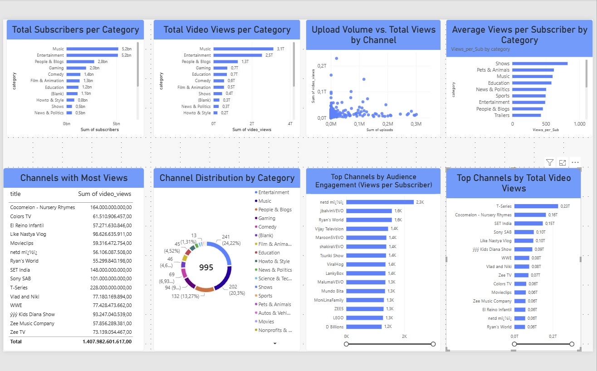

# 📊 YouTube Global Market Dynamics: Performance & Efficiency Analysis

## 1. Header & Executive Summary
This project delivers a comprehensive, data-driven analysis of the global top-performing YouTube channels using Power BI and DAX. By analyzing high-level channel metrics,
the study reveals two distinct paths to platform dominance: high-volume content production versus high-efficiency subscriber retention.
The insights generated provide digital media strategists and content networks with actionable, data-backed frameworks to optimize audience reach, conversion, and publishing models.

---

## 2. Business Problem & Context
In the highly saturated digital creator economy, media companies and digital agencies struggle to optimize capital allocation between video output volume and audience engagement. 

**Key Business Questions Addressed:**
* Does high video publishing volume directly correlate with overall audience reach?
* Which content categories achieve maximum viewer efficiency per subscriber?
* What structural attributes define top-tier digital media channels?

By solving these questions, content creators, media conglomerates, and brand advertisers can better allocate production budgets, refine category targeting, and design sustainable content growth strategies.

---

## 3. Data Architecture & Skills Used
* **Primary Tools:** Power BI Desktop, DAX (Data Analysis Expressions), Data Modeling.
* **Core Analytics Techniques:** Custom Ratio Metrics, Top-N Filtering, Correlation Mapping, Multi-Dimensional Categorical Aggregation.
* **Key DAX Measures Created:**
  ```dax
  Views_per_Sub = DIVIDE(SUM('public youtube_statistics'[video views]), SUM('public youtube_statistics'[subscribers]), 0)

## 4. Methodology & Data Pipeline

    Data Ingestion & Cleaning: Imported raw platform dataset (youtube_statistics), sanitized categorical text labels, removed duplicates, and resolved null values across key numeric metrics.

    Data Modeling & Measure Creation: Defined custom DAX calculation measures to evaluate channel loyalty and viewing efficiency independently of absolute channel size.

    Dashboard Engineering: Built an intuitive, minimalist interactive Power BI dashboard enforcing strict design principles: high contrast, zero clutter, and clear structural hierarchy.

    Insight Extraction: Synthesized quantitative trends into strategic, executive-ready business recommendations.

## 5. Key Results & Dashboard Preview



Q1: Category Performance (Total Views & Subscribers)

Key Insights:

    Dominant Categories: Music and Entertainment lead the platform by a substantial margin in both total views and accumulated subscriber bases.

    Broad Market Appeal: High-capital production categories drive mass platform adoption, serving as the primary traffic engines for YouTube overall.

Q2: Upload Volume vs. Total Views Correlation

Key Insights:

    Strategy Divergence: There is no linear dependency between video uploads and total viewership.

    Efficiency vs. Volume Models: Channels split into two distinct operational paradigms:

        Volume-Driven (e.g., SET India): Relies on massive publishing frequency (116k+ uploads) to build cumulative reach.

        Efficiency-Driven (e.g., Cocomelon): Generates tens of billions of views with under 1,000 uploads due to high repeat consumption per asset.

Q3: Channel Title Patterns & Naming Conventions

Key Insights:

    Brand Clarity: Top-tier channels utilize concise, highly searchable, and universally recognizable channel names.

    Global Localization: Multi-market networks frequently embed regional descriptors (e.g., Zee TV, SET India) or universal content tags (e.g., Kids, Music) to streamline brand positioning.

Q4: Channel Distribution by Category

Key Insights:

    Market Saturation: Entertainment, Music, and People & Blogs account for the vast majority of all top-performing channels.

    Niche Opportunities: High-engagement categories like Gaming or Education present lower total channel counts among the top 1,000, indicating untapped vertical potential with less direct competition at the elite level.

Q5: Category Efficiency (Views per Subscriber Ratio)

Key Insights:

    Engagement Asymmetry: High subscriber count does not automatically guarantee proportional view velocity.

    Top Efficiency Sectors: Kids and Music categories outperform others in views per subscriber due to algorithmic replay habits (especially in children's media) and playlist-based audio consumption.

Q6: Audience Loyalty & Channel Weight (Top Channels by Ratio)

Key Insights:

    Loyalty Leaders: Top-ranking channels in Views_per_Sub reflect deeply committed niche audiences and highly effective content recommendation loops.

    Monetization Value: Highly efficient channels represent premium advertising targets due to active, returning viewer interactions rather than passive subscriber bases.

Q7: Platform Giants (Top 15 Channels by Total Reach)

Key Insights:

    Market Concentration: A handful of hyper-scaled media entities (e.g., T-Series, Cocomelon, SET India) hold a disproportionate share of total platform views.

    Geographic Expansion: Emerging markets, particularly India, represent the strongest market share drivers among top global media properties.

6. Business Recommendations

    Adopt "Quality & Replayability" over Pure Volume: Media networks should prioritize evergreen, re-watchable content architectures (similar to the Kids/Music model)
    rather than unsustainable daily publishing schedules.

    Category Targeting for Ad Spend: Advertisers seeking guaranteed impression velocity should target high-efficiency categories (Kids/Music), whereas brands seeking broad reach should leverage Entertainment.

    Optimize Channel Naming for Searchability: Digital creators expanding across markets should adopt short, localized, and intent-focused naming frameworks.

7. Next Steps / Future Improvements

    Granular Asset Analytics: Integrate video-level metrics (CTR, Average View Duration, Shorts vs. Long-form ratio) to evaluate micro-level performance drivers.

    Monetization Modeling: Incorporate category-specific CPM estimates to calculate dynamic ad revenue potential per channel.

    Time-Series Forecasting: Apply predictive trend modeling on historical publishing dates to forecast subscriber growth velocity.
